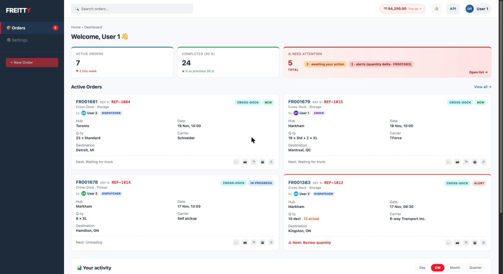
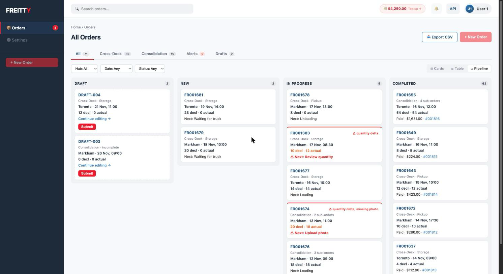
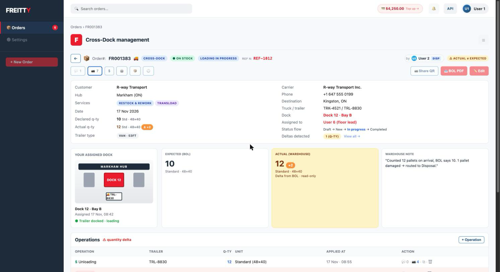
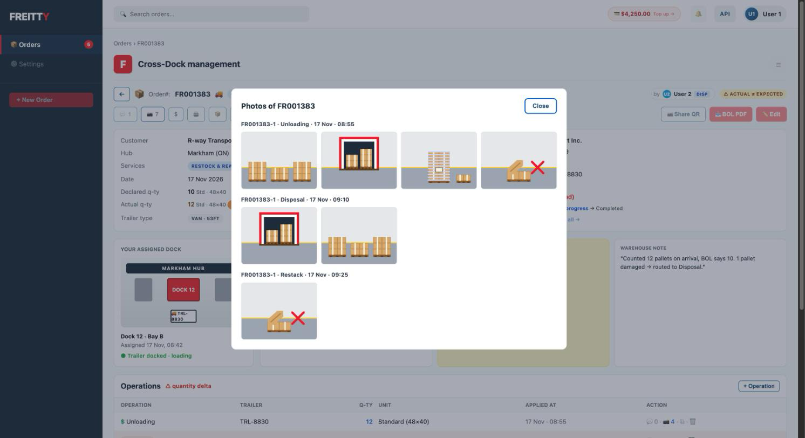
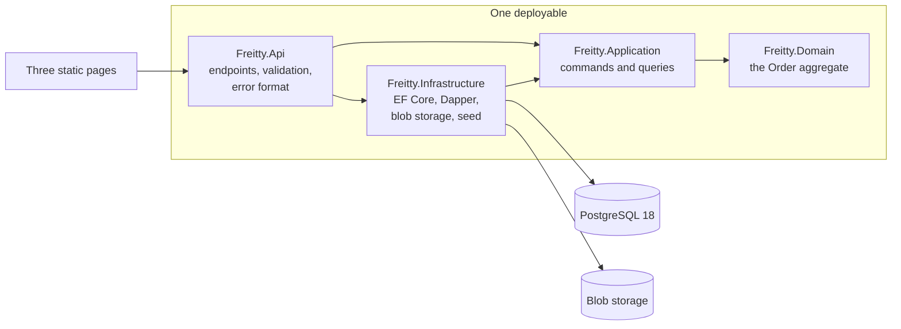
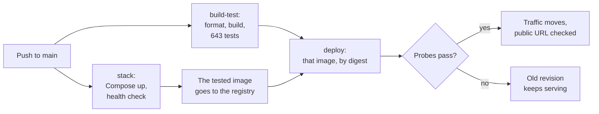

# Freitty Cabinet API

The backend behind a logistics client cabinet — a dashboard, an order list and an order page —
on .NET 10, FastEndpoints, EF Core and PostgreSQL. A test assignment for a backend role.

[**Live demo**](https://freitty-cabinet.purplemoss-8046cc4d.northeurope.azurecontainerapps.io/) · [Presentation (in Ukrainian)](https://bohdan-ivaniichuk.github.io/freitty-cabinet-api/) · [API reference](https://freitty-cabinet.purplemoss-8046cc4d.northeurope.azurecontainerapps.io/scalar/) · [Where to start reading](#where-to-start-reading) ·
[How it is built](#how-it-is-built) · [Decisions](docs/adr) · [Known limits](#known-limits) ·
[Run locally](#run-locally)

[](https://github.com/bohdan-ivaniichuk/freitty-cabinet-api/actions/workflows/ci.yml)

<a href="https://freitty-cabinet.purplemoss-8046cc4d.northeurope.azurecontainerapps.io/"></a>

## What this is

The brief hands over one HTML file with three finished screens and asks for the backend that
feeds them: a domain model and a schema designed from the mockup, PostgreSQL, filtering, search
and pagination on the database side, and a deployed application.

This repository is that backend, the three pages wired to it, and the reasoning behind both: the
plan, a spec for every step, and a record of every decision a reviewer could question. This page
is a guide to it — what runs, how it is built, and where to look first.

## Where to start reading

| If you want to see | Open |
|---|---|
| The domain model and its rules | [`Order.cs`](src/Freitty.Domain/Orders/Order.cs), [`Shipment.cs`](src/Freitty.Domain/Orders/Shipment.cs) — statuses, quantities, alerts; the vocabulary is in [`CONTEXT.md`](CONTEXT.md) |
| The schema | [`docs/er-diagram.md`](docs/er-diagram.md), the [EF Core configurations](src/Freitty.Infrastructure/Persistence/Configurations) and the [migrations](src/Freitty.Infrastructure/Persistence/Migrations) |
| Filtering, search and pagination in SQL | [`OrderFilter.cs`](src/Freitty.Application/Orders/OrderFilter.cs), [`OrderListSort.cs`](src/Freitty.Application/Orders/OrderListSort.cs), [`OrderSearch.cs`](src/Freitty.Infrastructure/Orders/OrderSearch.cs), [`ListOrdersQueryHandler.cs`](src/Freitty.Application/Orders/ListOrders/ListOrdersQueryHandler.cs) |
| Aggregates written by hand | [`DashboardSql.cs`](src/Freitty.Infrastructure/Dashboard/DashboardSql.cs) — the dashboard through Dapper |
| Indexes and their query plans | [`docs/explain/`](docs/explain) — before and after, on a volume data set |
| A write: transaction and concurrency | [`RecordOperationCommandHandler.cs`](src/Freitty.Application/Orders/RecordOperation/RecordOperationCommandHandler.cs), then [`SubmitOrderCommandHandler.cs`](src/Freitty.Application/Orders/SubmitOrder/SubmitOrderCommandHandler.cs) and [`AttachPhotosCommandHandler.cs`](src/Freitty.Application/Orders/AttachPhotos/AttachPhotosCommandHandler.cs) |
| How a request travels | An endpoint folder such as [`Orders/RecordOperation`](src/Freitty.Api/Endpoints/Orders/RecordOperation), the routes in [`ApiRoutes.cs`](src/Freitty.Api/Endpoints/ApiRoutes.cs), the pipeline in [`Pipeline/`](src/Freitty.Api/Pipeline), the errors in [`Errors/`](src/Freitty.Api/Errors) |
| Tests | Domain rules in [`Freitty.Domain.Tests`](tests/Freitty.Domain.Tests/Orders); the API against a real PostgreSQL in [`Freitty.Api.IntegrationTests`](tests/Freitty.Api.IntegrationTests/Orders), including the race tests |
| Why something is the way it is | [`docs/adr/`](docs/adr) — seventeen decisions with their alternatives; [`docs/plan.md`](docs/plan.md) — the plan made first |
| The release pipeline | [`.github/workflows/ci.yml`](.github/workflows/ci.yml) and the runbook, [`docs/deployment.md`](docs/deployment.md) |

## See it running

Everything below opens on the deployed demo. Its sample data is rebuilt every night and at every
release, so anything you record there is yours to break.

| Open | What to look at |
|---|---|
| [Dashboard](https://freitty-cabinet.purplemoss-8046cc4d.northeurope.azurecontainerapps.io/) | The tiles, the first active orders, the activity chart with its four periods |
| [Order List](https://freitty-cabinet.purplemoss-8046cc4d.northeurope.azurecontainerapps.io/orders.html) | Tabs with counters, filters, search and pages — as [cards](https://freitty-cabinet.purplemoss-8046cc4d.northeurope.azurecontainerapps.io/orders.html), a [table](https://freitty-cabinet.purplemoss-8046cc4d.northeurope.azurecontainerapps.io/orders.html?view=table) or a [pipeline board](https://freitty-cabinet.purplemoss-8046cc4d.northeurope.azurecontainerapps.io/orders.html?view=pipeline), where a draft is submitted by dragging it to New |
| [Order FR001383](https://freitty-cabinet.purplemoss-8046cc4d.northeurope.azurecontainerapps.io/order.html?n=FR001383) | An order in progress with a quantity delta: record an operation with **+ Operation**, open the photos with 📷 |
| [Order FR001674](https://freitty-cabinet.purplemoss-8046cc4d.northeurope.azurecontainerapps.io/order.html?n=FR001674) | An order with a missing photo: uploading one to its Unloading closes the alert |
| [API reference](https://freitty-cabinet.purplemoss-8046cc4d.northeurope.azurecontainerapps.io/scalar/) | Every endpoint with its request, responses and errors; requests can be sent from the page |
| [OpenAPI document](https://freitty-cabinet.purplemoss-8046cc4d.northeurope.azurecontainerapps.io/openapi/v1.json) | The same contract as JSON |

<table>
<tr>
<td width="33%"><a href="https://freitty-cabinet.purplemoss-8046cc4d.northeurope.azurecontainerapps.io/orders.html?view=pipeline"></a></td>
<td width="33%"><a href="https://freitty-cabinet.purplemoss-8046cc4d.northeurope.azurecontainerapps.io/order.html?n=FR001383"></a></td>
<td width="33%"><a href="https://freitty-cabinet.purplemoss-8046cc4d.northeurope.azurecontainerapps.io/order.html?n=FR001383"></a></td>
</tr>
<tr>
<td align="center"><sub>The pipeline board</sub></td>
<td align="center"><sub>An order</sub></td>
<td align="center"><sub>The photos of its operations</sub></td>
</tr>
</table>

The demo is temporary. Once it is taken down these links stop working, and
[`docker compose up`](#run-locally) gives the same application on `localhost:8080`.

## What it does

**What the brief asks for**

- **Dashboard** — active orders with this week's change, orders completed in thirty days against
  the thirty before, what needs the client's attention, the first active orders, and an activity
  chart by day, week, month or quarter in one reporting time zone.
- **Order List** — five tabs with counters, filters by hub, date and status, search by order
  number and reference number, pagination — all of it done by the database.
- **Order Detail** — the order with its shipments, declared and actual quantities, dock
  assignment, operations, alerts and supplies.
- **Sample data** — 71 orders built through the domain model, so they obey the rules the API
  enforces; dates are kept relative to today.

**What was added beyond it**

- **Recording an operation** — the first write: a transaction, optimistic concurrency on the
  order's version, and a quantity delta that raises or resolves an alert.
- **A pipeline board** — the mockup's third layout: one column per status, and a draft that is
  submitted by dragging it to New, under an official number from a database sequence.
- **Photos** — uploaded from the order page into blob storage, checked by content, served by the
  API; the photo an Unloading lacks closes its Missing photo alert.
- **CSV export, a table layout**, and views that change in place, with the state in the URL.
- **CI/CD to Azure**, and sample data that rebuilds itself so the demo never ages.

**What was left out on purpose** — sign-in, real payments, and creating an order: the aggregate
supports every step of it and the sample data is built that way, but the mockup has no screen
for it.

## How it is built



- **The dependencies point inward.** The domain knows nothing of the web or the database; the
  application knows ports (`IAppDbContext`, `IPhotoStorage`, `IOrderNumbers`), not their
  implementations.
- **One operation, one folder** — a query or a command, its handler, its validator. An endpoint
  only maps a request to it and a result to a response
  ([ADR 0009](docs/adr/0009-fastendpoints-and-its-command-bus.md)).
- **Reads and writes take different roads.** A read projects straight to a DTO in SQL, with
  Dapper for the dashboard's aggregates
  ([ADR 0011](docs/adr/0011-dapper-for-dashboard-aggregates.md)); a write loads the aggregate,
  calls one business method and saves under a version check
  ([ADR 0013](docs/adr/0013-optimistic-concurrency-on-order-version.md)).
- **One shape for every error** — `application/problem+json` with a stable `code`, so a client
  branches on a code, not on a sentence.
- **What is not here, deliberately** — MediatR, AutoMapper, generic repositories, a value object
  for every field, a front-end framework. [`docs/plan.md`](docs/plan.md) says why.

Where the decisions are:

| Read | What it is |
|---|---|
| [`docs/plan.md`](docs/plan.md) | The plan made before the first line of code, and the order of work |
| [`CONTEXT.md`](CONTEXT.md) | The vocabulary: what an Order, a Shipment, an Operation and an Alert are |
| [`docs/er-diagram.md`](docs/er-diagram.md) | The schema and what references what |
| [`docs/adr/`](docs/adr) | Seventeen decisions, each with its alternatives and what it costs |
| [`docs/steps/`](docs/steps) | The spec of every step, written before its code |
| [`docs/explain/`](docs/explain) | Query plans before and after each index, on a volume data set |
| [`docs/mockup-analysis.md`](docs/mockup-analysis.md) | Where the mockup contradicts itself and how the model settles it |
| [`docs/engineering/code-rules.md`](docs/engineering/code-rules.md) | The rules every C# file follows |
| [`docs/deployment.md`](docs/deployment.md) | The runbook: provisioning, operations, teardown |

## The API

All under `/api/v1`. A `GET` below opens on the demo; the writes are best tried from the
[API reference](https://freitty-cabinet.purplemoss-8046cc4d.northeurope.azurecontainerapps.io/scalar/).

| Method | Route | What |
|---|---|---|
| `GET` | [`/api/v1/orders`](https://freitty-cabinet.purplemoss-8046cc4d.northeurope.azurecontainerapps.io/api/v1/orders) | One page of order cards, with the tabs, filters and search of the Order List |
| `GET` | [`/api/v1/orders/counts`](https://freitty-cabinet.purplemoss-8046cc4d.northeurope.azurecontainerapps.io/api/v1/orders/counts) | The counter of each Order List tab, under the same filters |
| `GET` | [`/api/v1/orders/export`](https://freitty-cabinet.purplemoss-8046cc4d.northeurope.azurecontainerapps.io/api/v1/orders/export) | The whole filtered Order List as a CSV file |
| `GET` | [`/api/v1/orders/pipeline`](https://freitty-cabinet.purplemoss-8046cc4d.northeurope.azurecontainerapps.io/api/v1/orders/pipeline) | The Order List as a board: every status with its total and first cards |
| `GET` | [`/api/v1/orders/{number}`](https://freitty-cabinet.purplemoss-8046cc4d.northeurope.azurecontainerapps.io/api/v1/orders/FR001383) | The detail of an order |
| `POST` | `/api/v1/orders/{number}/operations` | Records an operation on a shipment |
| `POST` | `/api/v1/orders/{number}/submit` | Submits a draft: Ready, under the next official number |
| `GET` | [`/api/v1/orders/{number}/photos`](https://freitty-cabinet.purplemoss-8046cc4d.northeurope.azurecontainerapps.io/api/v1/orders/FR001383/photos) | Every photo of an order, in the order of its page |
| `GET` | `/api/v1/orders/{number}/photos/{photoId}` | The image of a photo, streamed from blob storage |
| `POST` | `/api/v1/orders/{number}/operations/{operationId}/photos` | Uploads one to five photos of an operation (multipart) |
| `GET` | [`/api/v1/dashboard`](https://freitty-cabinet.purplemoss-8046cc4d.northeurope.azurecontainerapps.io/api/v1/dashboard) | The tiles, the first active orders and the activity chart |
| `GET` | [`/api/v1/hubs`](https://freitty-cabinet.purplemoss-8046cc4d.northeurope.azurecontainerapps.io/api/v1/hubs) | The options of the Hub filter |
| `GET` | [`/api/v1/me`](https://freitty-cabinet.purplemoss-8046cc4d.northeurope.azurecontainerapps.io/api/v1/me) | The current user, the company and the number on the Orders badge |

## How a release happens



The demo runs on Azure, in one resource group
([ADR 0014](docs/adr/0014-azure-container-apps-and-managed-postgresql.md)): a container app with
one always-on replica, a managed PostgreSQL 18, a private container registry, a storage account
for the photos and a log workspace. GitHub signs in to Azure with OIDC, so the repository holds
no cloud credential.

The new revision migrates the database while the old one still serves, so every migration is
additive ([ADR 0007](docs/adr/0007-migrations-applied-at-startup.md)). The behaviour was measured
on the live application: a revision that could not start never took traffic, and a healthy one
took over without a failed request. The commands — provisioning, operations, rollback, teardown —
are in the runbook, [`docs/deployment.md`](docs/deployment.md).

## Known limits

- **One instance.** The nightly rebuild of the sample data and the request gate around it assume
  a single replica ([ADR 0015](docs/adr/0015-the-demo-rebuilds-its-sample-data.md)).
- **No sign-in.** The current user is one seeded user, and the demo is open to anyone with the
  link. Uploads are therefore capped, limited and can be switched off
  ([ADR 0017](docs/adr/0017-photos-in-blob-storage-behind-the-api.md)); the caps are shared by
  all visitors.
- **A photo is an image by its signature only.** A few bytes that begin like a JPEG are stored
  and shown as a broken picture; decoding every upload was left out with the imaging library.
- **The application connects as the database administrator.** Accepted for synthetic data; a
  role of its own is the first step for anything real.
- **Four pipeline columns, not the mockup's seven.** Three of the seven are stages the model
  does not have; the board shows the statuses the domain owns.
- **Official numbers are unique and increasing, not dense.** A submit that loses a race leaves a
  gap ([ADR 0016](docs/adr/0016-official-order-numbers-from-a-sequence.md)).

## Run locally

You need:

- [Docker](https://docs.docker.com/get-docker/) with Docker Compose — enough to run the app.
- [.NET 10 SDK](https://dotnet.microsoft.com/download/dotnet/10.0) — only for `dotnet run` and
  `dotnet test`.

```bash
docker compose up -d --build --wait
```

This starts PostgreSQL, Azurite — the Azure Blob Storage emulator, which keeps the photos — and
the API; host ports 5432, 10000 and 8080 must be free. When the command returns, all three are
healthy and the cabinet is at http://localhost:8080/, with the API reference at
http://localhost:8080/scalar/. Stop with `docker compose down`; add `-v` to delete the database
and the stored photos as well.

```bash
dotnet test
```

Integration tests start their own PostgreSQL and Azurite containers through Testcontainers, so
Docker must be running; the Compose stack does not need to be.

<details>
<summary><b>Addresses, settings and what happens at startup</b></summary>

<br>

| URL | What |
|---|---|
| http://localhost:8080/ | The cabinet: the Dashboard, the order list (`/orders.html`) and an order (`/order.html?n=FR001383`) |
| http://localhost:8080/health/live | Liveness — `200` while the process serves requests |
| http://localhost:8080/health/ready | Readiness — `200` when the API reaches PostgreSQL, `503` otherwise |
| http://localhost:8080/scalar | The API reference (Scalar), with requests that can be sent from the page |
| http://localhost:8080/openapi/v1.json | The OpenAPI document; the endpoints are under `/api/v1` |

The API applies pending database migrations at startup, before it listens. If it cannot — the database is
unreachable or a migration fails — the process exits instead of serving requests. The database itself must
already exist (Compose creates it); instances starting together take turns to migrate it.

Photos are blobs of the private container `photos`, which the API creates at startup and serves
itself ([ADR 0017](docs/adr/0017-photos-in-blob-storage-behind-the-api.md)). The API reads the
storage's connection string from `ConnectionStrings__PhotoStorage` and does not start without it;
Compose points it at Azurite with the emulator's well-known development account, published on
loopback only. `Photos__UploadsEnabled` set to `false` switches uploads off (`503`); stored photos
are still served.

The API reads its reporting time zone — where "today" and "this week" begin — from `Cabinet__TimeZone`
(`America/Toronto` by default, in `appsettings.json`). It must be an IANA id; any other value stops the startup.

</details>

<details>
<summary><b>Running the API from source</b></summary>

<br>

Start only the database and the photo storage, then run the API:

```bash
docker compose up -d --wait postgres azurite
dotnet run --project src/Freitty.Api
```

`appsettings.Development.json` points the API at both: PostgreSQL on port 5432 and Azurite on
10000 (`UseDevelopmentStorage=true`).

The API listens on http://localhost:5080 (for example, http://localhost:5080/health/ready): the cabinet
at http://localhost:5080/ and the API reference at http://localhost:5080/scalar. In Development the SQL
that EF Core sends is logged.

</details>

<details>
<summary><b>The sample data and how it stays fresh</b></summary>

<br>

When `Seed:Enabled` is `true` and the database is empty — it has no company — the API fills it with
sample data at startup, right after the migrations:

- the company R-way Transport with four users, the Markham and Toronto hubs, three carriers, two
  services and sixteen supply items;
- eleven scripted orders in every status, two of them with open alerts, that the screens and the
  demo rely on — among them two drafts: DRAFT-003, which lacks what a submit needs, and DRAFT-004,
  which can be submitted from the Pipeline layout of the Order List;
- sixty completed orders over the last three months, for the dashboard figures and the chart;
- an invoice for every completed order, one of them unpaid;
- a photo for every photo an operation counts: each is a row that points at one of four sample
  images — flat placeholder pictures drawn by
  `src/Freitty.Infrastructure/Persistence/Seed/Images/draw_sample_photos.py`, not photographs —
  which the API uploads to the photo storage whenever it seeds.

The setting is on in `appsettings.Development.json` and in `docker-compose.yml`, and off everywhere
else. Every order is built through the domain model, so the data obeys the same rules as an order
made through the API.

Dates are relative to the day before the database was seeded. The Docker stack — the demo — keeps
them fresh: `Seed__Refresh` is `true` in `docker-compose.yml`, so the API rebuilds the sample data at
every start and again soon after midnight in Toronto, when that day changes (it checks every 15
minutes). A rebuild deletes everything in the database, operations recorded from an order page
included, and seeds again in one transaction; requests wait for it, well under a second. Photos
uploaded from an order page are deleted with it, one blob at a time, which adds a little to that
wait; the sample images stay. To keep
what you recorded, set `Seed__Refresh` to `"false"` in `docker-compose.yml`, or remove it.

Without `Seed:Refresh` — as with `dotnet run`, where `appsettings.Development.json` turns on only
`Seed:Enabled` — the data ages: a database seeded a week ago shows a week-old picture, and a database
that already has a company is left as it is. To start over, empty the database:

```bash
docker compose down -v
docker compose up -d --build --wait
```

or, running the API from source:

```bash
docker compose down -v
docker compose up -d --wait postgres azurite
dotnet run --project src/Freitty.Api
```

</details>

<details>
<summary><b>Database migrations</b></summary>

<br>

Migrations live in `src/Freitty.Infrastructure/Persistence/Migrations` and are applied by the API at startup.
To add one, restore the local tools once, then run:

```bash
dotnet tool restore
dotnet ef migrations add <Name> --project src/Freitty.Infrastructure --startup-project src/Freitty.Api --output-dir Persistence/Migrations
```

A migration that has reached `main` is never edited; a change is a new migration.

The first start against an empty database logs one `Failed executing DbCommand` at `ERR`: EF Core
reads its migrations history table before it has created it. The migrations follow on the next lines.

</details>

## Repository map

| Path | What is there |
|---|---|
| [`src/Freitty.Domain`](src/Freitty.Domain) | The `Order` aggregate with its shipments, operations, alerts and photos; no dependencies |
| [`src/Freitty.Application`](src/Freitty.Application) | Queries, commands, validators and the ports they need |
| [`src/Freitty.Infrastructure`](src/Freitty.Infrastructure) | EF Core mappings and migrations, the Dapper dashboard, blob storage, the seed |
| [`src/Freitty.Api`](src/Freitty.Api) | Endpoints, the error format, OpenAPI, and the three pages under `wwwroot` |
| [`tests/Freitty.Domain.Tests`](tests/Freitty.Domain.Tests) | Unit tests of the domain rules |
| [`tests/Freitty.Api.IntegrationTests`](tests/Freitty.Api.IntegrationTests) | Tests through HTTP against a real PostgreSQL and Azurite |
| [`docs`](docs) | The plan, the decisions, the step specs, the query plans, the runbook |
| [`deploy`](deploy) · [`.github/workflows`](.github/workflows) | The container template and the pipeline that releases it |
