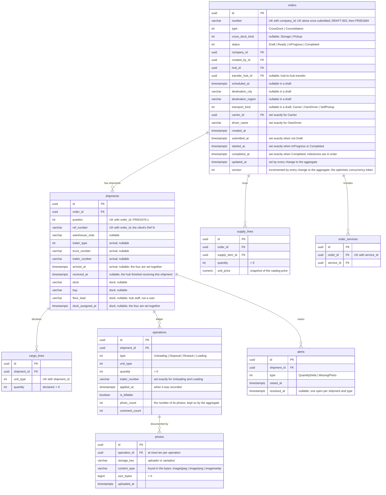
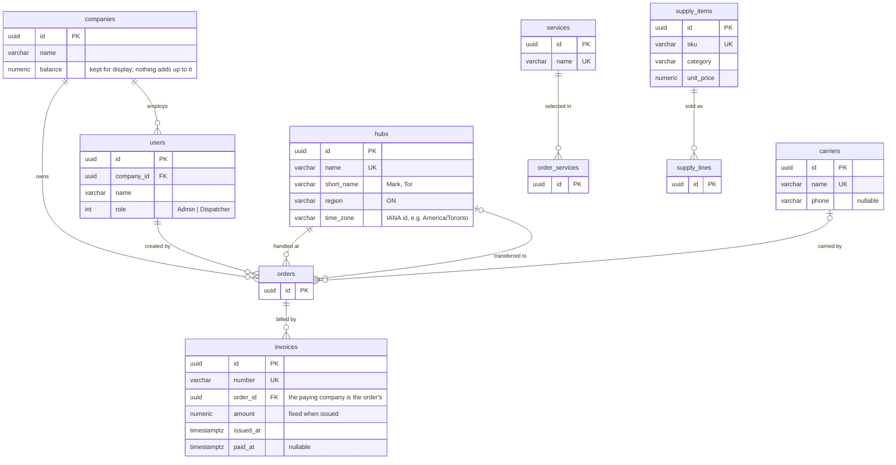

# ER diagram

The schema created by the `InitialSchema` migration
([step 2](steps/02-domain.md)), with the indexes of `OrderListIndexes`
([step 4](steps/04-order-list.md)) and the `photos` table of `OperationPhotos`
([step 12](steps/12-photos.md)). The bytes of a photo are not in the database: `storage_key` names
a blob of the private container `photos`
([ADR 0017](adr/0017-photos-in-blob-storage-behind-the-api.md)). Terms are defined in [`CONTEXT.md`](../CONTEXT.md).

Every `id` is a UUID v7 created by the domain. Instants are `timestamptz` in UTC. Enums are stored
as integers, each with a `CHECK` that lists the values of its enum.

## The `Order` aggregate

Everything in this diagram is loaded, changed and saved together, through `Order` only. A draft may
have no shipment yet; a submitted order has at least one.

What the diagram does not show because it is not stored:

| Shown on screen | Computed from |
|---|---|
| Declared quantity of a shipment or an order | `cargo_lines` |
| Actual quantity, Quantity delta | `operations` of type Unloading against `cargo_lines`; a shortage counts once `received_at` is set |
| On stock | `operations`: unloaded − disposed − loaded |
| "Trailers: 2 consolidated" | distinct `trailer_number` of Loading `operations` |
| An order "has an alert" | an `alerts` row with `resolved_at IS NULL` on any of its shipments |
| Supply line total and subtotal | `supply_lines.quantity × unit_price` |
| Photo and comment counters in the toolbar | sums of `photo_count` and `comment_count` over `operations` |

## The order and what it refers to

## Delete behaviour

- `CASCADE` for rows that only describe an order: `shipments`, `supply_lines`,
  `order_services` follow their `orders` row; `cargo_lines` follow their `shipments` row; `photos`
  follow their `operations` row. Their blobs do not: a rebuild of the sample data deletes every
  uploaded one.
- `RESTRICT` for the ledger: a `shipments` row that has `operations` or `alerts` cannot be
  deleted, and so neither can its order. A draft has neither, so a draft can be deleted.
- `RESTRICT` everywhere else: a company, user, hub, carrier, service or supply item that an order
  refers to cannot be deleted, and neither can an order that has an invoice.

## Indexes

Besides the primary keys, the unique keys named in the diagrams and an index per foreign key,
`alerts` has a partial unique index: `ix_alerts_shipment_id_type` on `(shipment_id, type) WHERE
resolved_at IS NULL`, one open Alert per shipment and type. Its name is matched to turn a lost race
to raise the same Alert into `409`
([ADR 0013](adr/0013-optimistic-concurrency-on-order-version.md)).

The Order List has three of its own (migration `OrderListIndexes`, which also enables `pg_trgm`):

| Index | On | Serves |
|---|---|---|
| `ix_orders_number_trgm` | `orders (number)`, GIN, `gin_trgm_ops` | the search's `number ILIKE '%…%'` |
| `ix_shipments_ref_number_trgm` | `shipments (ref_number)`, GIN, `gin_trgm_ops` | the search's `ref_number ILIKE '%…%'` |
| `ix_orders_company_id_scheduled_at_id` | `orders (company_id, scheduled_at DESC, id DESC)` | the default list of a company, newest Scheduled date first, without a sort |

The Pipeline board has one more (migration `PipelineIndex`):

| Index | On | Serves |
|---|---|---|
| `ix_orders_company_id_status_scheduled_at_id` | `orders (company_id, status, scheduled_at DESC, id DESC)` | the board's totals per status and its pick of the first orders of each, as index-only scans; the list filtered by status |

Official order numbers come from the sequence `order_number_seq` (migration
`OrderNumberSequence`, [ADR 0016](adr/0016-official-order-numbers-from-a-sequence.md)).

The query plans, before and after, are in [`explain/`](explain/README.md).
